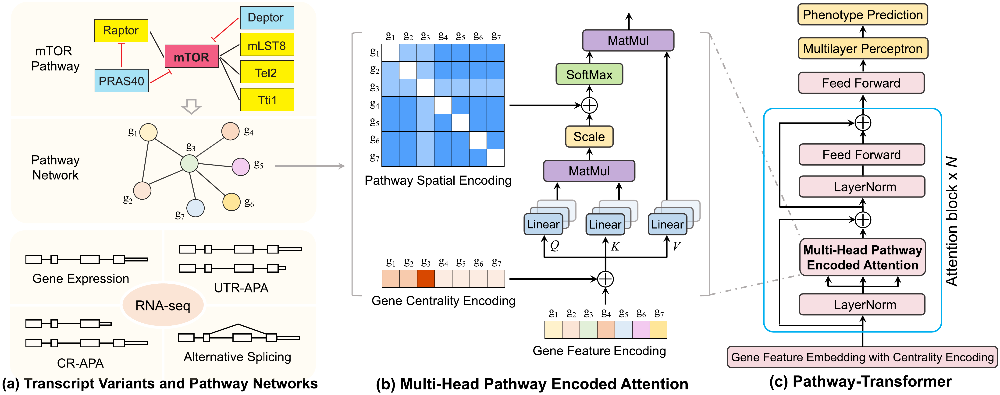

# Pathway-Transformer

Pathway-Transformer predicts cancer phenotypes, here estrogen- and progesterone-receptor (ER/PR) status of TCGA
breast cancers. It integrates four transcript-level features from the same RNA-seq data: gene expression, CR-APA
transcript ratio, UTR-APA transcript ratio and alternative-splicing PSI. It also encodes the structure of KEGG
pathway networks.



One model is trained per KEGG pathway, with every gene of the pathway as a token:

* **Gene feature encoding.** A gene's token is `b_g + sum_c z_gc * w_gc`, summed over its feature channels `c`.
  `b_g` encodes gene identity, and a learned embedding is added for a channel in which the gene has no value.
  Expression is `log2(x + 1)`. Each gene/channel is scaled as `(x - median) / (IQR / 1.349)` using training-fold
  statistics, then compressed with `arcsinh`.
* **Gene centrality encoding.** In-degree and out-degree embeddings are added to the gene tokens.
* **Pathway spatial encoding.** Each attention head is biased by the directed shortest-path distance between two
  genes and by the KEGG edge types along that path, up to 5 hops.
* **Prediction.** A virtual pathway token attends to all genes, and its final representation gives the prediction.
  Three models (seeds) are trained per fold and their probabilities are averaged.

## Files

| File | Purpose |
|---|---|
| `prepare_data.py` | Builds the model inputs from the raw data: feature tables of the pathway genes and graph structures of the 89 pathways |
| `pathway_transformer.py` | Model, training and evaluation; runs task/feature/pathway jobs one after another on one device |
| `run.py` | Spreads the pathways over GPU workers, resumes interrupted runs and summarizes the results |
| `tune.py` | Hyperparameter search ranked by validation AUROC |

## Installation

```bash
conda create -n pathway_transformer python=3.11
conda activate pathway_transformer
pip install torch numpy pandas scikit-learn openpyxl
```

Tested with Python 3.11, PyTorch 2.10 (CUDA 13.0), NumPy 2.4, pandas 3.0, scikit-learn 1.8 and openpyxl 3.1.
A CUDA GPU is recommended; the code also runs on CPU, more slowly.

## Data

All data are public in the Kaggle dataset
[Data for Pathway-Transformer](https://www.kaggle.com/datasets/sudiptobaul/data-for-pathway-transformer).
Download it into `raw_data/`, either from the web page or with the Kaggle command-line tool:

```bash
kaggle datasets download -d sudiptobaul/data-for-pathway-transformer -p raw_data --unzip
```

| File | Content |
|---|---|
| `brca_gene_expression.xlsx` | Gene expression (genes x samples) |
| `brca_crapa.xlsx` | CR-APA transcript ratio |
| `brca_utrapa.xlsx` | UTR-APA transcript ratio |
| `brca_asquant.xlsx` | Alternative-splicing PSI |
| `brca_tcga_clinical_data.tsv` | Clinical data with `ER Status By IHC` and `PR status by ihc` |
| `pathway_csv/hsa*.csv` | Relations (`from_genesymbols`, `to_genesymbols`, `subtype`) of the 89 KEGG pathways |

## 1. Prepare the inputs

```bash
python prepare_data.py --raw_dir raw_data --out_dir data
```

This writes `data/channels/{gene,crapa,utrapa,asquant}.csv.gz`, which holds the values of the 3,244 pathway genes.
It also writes one `data/structures/<pathway>.npz` per pathway, holding:

* the sorted gene list;
* in- and out-degrees;
* shortest-path distances;
* the edge types along each shortest path.

This step takes about 10 minutes, mostly to read the Excel files.

## 2. Train and evaluate

Evaluation is five-fold cross-validation:

* **Samples.** The cohort is the samples with an ER (or PR) label and all four channels: 1,044 for ER and 1,041
  for PR, sorted by sample ID.
* **Folds.** Samples are split by `StratifiedKFold(5, shuffle=True, random_state=4)`. For test fold `k`, fold
  `(k + 1) mod 5` is the validation fold, and the other three folds are used for training.
* **Seeds.** Each fold trains seeds `0 + 100k`, `1 + 100k` and `2 + 100k`. Each seed keeps the epoch with the best
  validation AUROC, and their test probabilities are averaged.
* **Metrics.** AUROC and AUPRC are computed on the test fold. F1 and MCC use the Youden threshold of the test fold;
  the `*_valthr` columns use the threshold of the validation fold instead.

One pathway, ER, all four features, test fold 0:

```bash
python pathway_transformer.py --tasks ER --features all --pathways hsa04915 --folds 0 \
    --output_dir results/example/folds
```

All 89 pathways, both tasks, the four feature configurations and five folds, on two GPUs with four workers each:

```bash
python run.py --run_name table1 --tasks ER PR --features gene crapa gene_crapa all \
    --gpus 0 1 --workers_per_gpu 4
```

| `--features` | Channels |
|---|---|
| `gene` | Gene expression |
| `crapa` | CR-APA |
| `gene_crapa` | Gene expression and CR-APA |
| `all` | Gene expression, CR-APA, UTR-APA and AS |

`run.py` writes these files to `results/<run_name>/`:

* `folds/<task>_<features>_<pathway>.csv`: one row per test fold, with the metrics, validation metrics, best epochs
  and run time;
* `per_pathway.csv`: the mean over the folds;
* `summary.csv`: the mean and SD over pathways for each task and feature configuration;
* `logs/worker<k>.log`: each worker's log.

Jobs whose result file already exists are skipped. To resume an interrupted run, repeat the command; to start a
run again, delete its folder.

**Run time.** One pathway and fold (three seeds) takes about 50 s on an NVIDIA RTX A4500 shared by six workers
(median over the 89 pathways). The largest pathway, hsa05200 (466 genes), takes about 9 minutes. Results can
differ slightly between GPUs and runs because some CUDA operations are not deterministic.

## 3. Hyperparameter tuning

The defaults are in `DEFAULTS` in `pathway_transformer.py` (Supplementary Table S1). Each one can be overridden
with `--config` in `pathway_transformer.py`, `run.py` and `tune.py`, for example
`--config '{"lr": 3e-4, "dropout": 0.2}'`.

| Hyperparameter | Default | Meaning |
|---|---|---|
| `d_model` | 64 | Hidden dimension of the tokens |
| `ffn_dim` | 128 | Hidden dimension of the feed-forward layers |
| `n_layers` | 2 | Number of Transformer blocks |
| `n_heads` | 4 | Attention heads (must divide `d_model`) |
| `dropout` / `attn_dropout` | 0.1 / 0.1 | Dropout on tokens and feed-forward layers / on attention weights |
| `lr` / `weight_decay` | 1e-3 / 1e-2 | AdamW learning rate and weight decay |
| `batch_size` | 64 | Training batch size |
| `max_epochs` / `warmup_epochs` | 150 / 5 | Training length; linear warm-up, then cosine decay to 0 |
| `patience` | 25 | Epochs without a better validation AUROC before training stops |
| `seeds` | [0, 1, 2] | Models averaged per fold (seed + 100 x fold) |

`tune.py` trains every configuration on the same pathways, tasks and folds and ranks the configurations by mean
validation AUROC. It never reads test metrics, so the test folds play no part in the choice. Its default is the
search used for the paper: hidden dimension 32 or 64 (feed-forward dimension twice as large) and learning rate
1e-3 or 3e-4, on six pathways of different sizes, for ER and PR with all four features and five folds. The
search is run with:

```bash
python tune.py --tune_name paper --gpus 0 1 --workers_per_gpu 4
```

The paper's search chose `d_model` 64 and `lr` 1e-3.

To search other hyperparameters, pass a grid (every combination is tried) or a list of configurations:

```bash
python tune.py --tune_name regularization --grid '{"dropout": [0.1, 0.2, 0.3], "weight_decay": [0.01, 0.1]}'
python tune.py --tune_name size --configs '[{"d_model": 64, "ffn_dim": 128}, {"d_model": 128, "ffn_dim": 256}]'
```

The `--tasks`, `--features`, `--pathways` and `--folds` options limit the search, as in `run.py`. Results are
written to `results/<tune_name>/<configuration>/`, and the ranking to `results/<tune_name>/tuning.csv`. Run the
best configuration on all pathways and folds with `run.py --config '<configuration>'`.

Guidelines:

* **Select on validation data only.** Choose by validation AUROC; reporting test results of several configurations
  and keeping the best would leak the test folds into the choice.
* **Tune on a subset.** Use a few pathways of different sizes; the cost of a job grows with the number of genes.
* **Keep heads compatible.** `n_heads` must divide `d_model`. For larger `d_model`, check GPU memory on the
  largest pathway (hsa05200) first.
